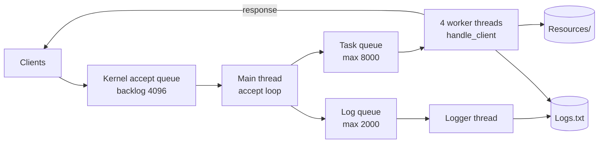

# Raw Server

A multi-threaded HTTP/1.1 static file server written in C++23 directly on POSIX sockets. No framework and no third-party libraries: the socket handling, request parsing, thread pool and logging are all in this repository.

It listens on port 4221 and serves files from `Resources/`.

## Features

- **Fixed-size thread pool.** Four worker threads take connections from a bounded queue (mutex + condition variable). The accept loop never performs I/O on a client socket.
- **Bounded everything.** Request size, file size, queue length, per-call socket timeouts and whole-request deadlines all have explicit limits, so a slow or hostile client cannot hold resources indefinitely.
- **Path traversal protection.** Request paths are canonicalised and must resolve inside `Resources/`.
- **Complete, checked writes.** Responses are sent in a loop that handles partial writes, `EINTR`, a send deadline and clients that disconnect mid-response.
- **Error handling without exceptions on the request path.** Receiving and parsing return `std::expected`, so every failure is a value the caller must handle.
- **Asynchronous connection logging.** Accept-loop log entries go through their own queue and thread, so logging does not slow down `accept()`.

## Quick start

Requires a C++23 compiler (`std::expected`): GCC 13 or later, or a recent Clang. Tested on Ubuntu 24.04 (GCC 13.3) and macOS (Apple Clang 21).

```bash
g++ -std=c++23 -O2 -pthread -I. SERVER.cpp -o server_fixed
```

```bash
./server_fixed
```

```bash
curl -i http://localhost:4221/
```

Run the server from the repository root: `Resources/` and the log file `Logs.txt` are resolved relative to the working directory.

## Architecture



Each worker handles one connection from start to finish:

1. Set receive and send timeouts on the socket.
2. Read until the end of the headers (`\r\n\r\n`), then the body if `Content-Length` is present.
3. Parse the request line and headers.
4. Map the URL path to a file under `Resources/` and reject anything that escapes it.
5. Read the file, build the response, send it under a deadline.
6. Close the connection.

| File | Responsibility |
|---|---|
| `SERVER.cpp` | Socket setup, accept loop, connection handler, path mapping, response building |
| `HTTP_request.hh` | Request receiving and parsing, socket and timing helpers |
| `thread_pool.hh` | Generic bounded thread pool, constrained with a C++20 concept |
| `Logger.hh` | Thread-safe singleton logger and the error-code table |
| `CONFIGS.hh` | Limits, timeouts, allowed methods, status codes |
| `loadtest.cpp` | Standalone load generator (Boost.Asio coroutines) |
| `metrics/` | Benchmark results and the script that produced them |

## Limits and behaviour

| Setting | Value |
|---|---|
| Port | 4221 |
| Worker threads | 4 |
| Task queue | 8,000 connections; further connections are dropped |
| Maximum request size | 1 MB |
| Maximum file size served | 10 MB |
| Socket receive / send timeout | 3 s / 2 s per call |
| Whole-request / whole-response deadline | 8 s / 8 s |
| Supported methods | `GET` |
| Connection handling | `Connection: close` on every response |

| Situation | Response |
|---|---|
| File found | `200 OK` with a `Content-Type` from the file extension |
| Malformed request | `400 Bad Request` |
| File missing, path is a directory, or path leaves `Resources/` | `404 Not Found` |
| Method other than `GET` | `404 Not Found` (to become `405` with an `Allow` header) |
| Client stalls, disconnects or exceeds a size limit | Connection closed, event logged |

## Performance

Closed-loop test with [Fortio](https://github.com/fortio/fortio) over loopback, `GET /` (2,543 bytes), keep-alive off, 10 seconds per level, median of three runs. Machine: Apple M5, 10 cores, with the load generator on the same host.

| Connections | Throughput (req/s) | p50 | p99 | Errors |
|---|---|---|---|---|
| 1 | 7,902 | 0.15 ms | 0.20 ms | 0 |
| 10 | 26,038 | 0.36 ms | 0.58 ms | 0 |
| 100 | 27,846 | 3.31 ms | 4.35 ms | 0 |
| 800 | 28,194 | 27.59 ms | 82.87 ms | 0 |

Throughput levels off near 28,000 requests per second once the four workers are saturated; beyond that, added connections wait in the queue and latency rises in proportion. Full results, test conditions and reproduction steps are in [`metrics/mac_result/baseline_c16bea1/`](metrics/mac_result/baseline_c16bea1/README.md).

## Engineering notes

[`FIXED.md`](FIXED.md) records the significant defects found in this server, each with its symptom, root cause, fix and proof. It includes a process-killing `SIGPIPE` that only appeared under load, and unchecked partial writes.

## Known limitations

- **Blocking I/O, one connection per worker.** Four slow clients occupy every worker. An event-driven design (`epoll`/`kqueue`) is out of scope for this project.
- **No keep-alive.** Every request pays for a new TCP connection.
- **No TLS.**
- **Dropped connections are not closed.** When the task queue is full the connection is discarded without closing its file descriptor.
- **Whole file in memory.** Files are read fully before sending, which is why the served size is capped.

## Roadmap

1. Split `SERVER.cpp` into named components and move the build to CMake.
2. Put parsing behind an `IParser` interface, with [llhttp](https://github.com/nodejs/llhttp) as the default implementation and the current parser as the alternative.
3. Router, with `405 Method Not Allowed` and an `Allow` header for unsupported methods.
4. Middleware chain, graceful shutdown, keep-alive, rate limiting.
5. Structured logging and a test suite.
6. TLS.

## About

Built to understand what a web framework hides: TCP accept and backlog semantics, why blocking I/O needs timeouts, how threads share work safely, and where request parsing breaks on malformed or hostile input. Developed with Claude as a reviewer and explainer; the server code is written by hand.
